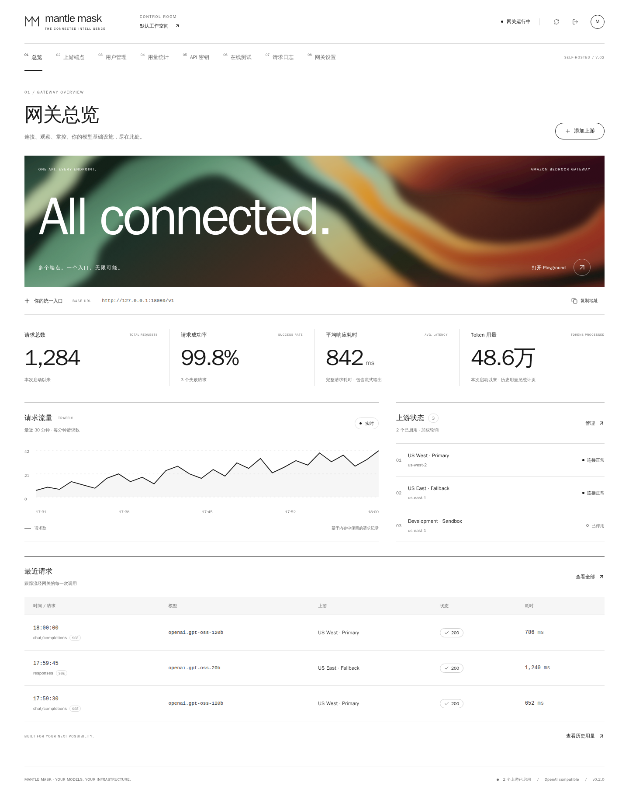

<div align="center">

# Mantle Mask

**让 Amazon Bedrock Mantle 成为你的 OpenAI 兼容 API**

多个上游，一个入口。自托管网关，搭配开箱即用的中文管理控制台。

[](https://github.com/hnewcity/mantle-mask/actions/workflows/ci.yml)


[](https://github.com/hnewcity/mantle-mask/pkgs/container/mantle-mask)
[](LICENSE)

[控制台预览](#preview) · [功能特性](#features) · [快速开始](#quick-start) · [客户端接入](#clients) · [Docker 部署](#docker) · [常见问题](#faq) · [参与贡献](#contributing)

</div>

---

Mantle Mask 使用 Go + Gin 转发请求，以 React + TypeScript 提供管理界面。前端直接嵌入单个 Go 二进制，运行时不需要 Node.js，也不需要外部数据库。

```text
OpenAI 兼容客户端 / OpenAI SDK
              │
     Chat Completions / Responses
              ▼
         Mantle Mask
     路由 · 鉴权 · 用量 · 控制台
              │
     Bedrock API Key / AWS SigV4
              ▼
     Amazon Bedrock Mantle
```

> [!NOTE]
> 本项目是非官方网关，与 Amazon Web Services 或 OpenAI 无隶属或背书关系。请使用自己有权使用的 Bedrock 凭据；模型、区域、权限与费用以上游服务为准。

<a id="preview"></a>

## 🖼️ 控制台预览



<sub>真实控制台截图，使用隔离的模拟数据；不是生产流量或性能基准，不包含真实账号、令牌或 AWS 凭据。</sub>

<a id="features"></a>

## ✨ 功能特性

| 功能 | 说明 |
| --- | --- |
| 🔌 **OpenAI 兼容接口** | Models、Chat Completions、Responses，支持 JSON 与 SSE 流式输出 |
| 🖥️ **中文控制台** | 总览、上游端点、用户、API 密钥、用量统计、Playground、日志与设置，适配移动端 |
| 🔀 **多上游路由** | 平滑加权轮询、模型别名、启停、故障冷却和切换 |
| 🔐 **双重 AWS 鉴权** | Bedrock API Key 或 SigV4，支持静态凭据、会话令牌、默认凭据链与 Profile |
| 🧵 **Responses 连续性** | Response ID 与原上游持久化绑定，支持多轮、读取、取消、删除和 input items |
| 👥 **多用户与密钥隔离** | 管理令牌与应用 Key 分离；每用户多个 Key，支持停用、撤销和个人用量查询 |
| 📊 **持久化用量** | SQLite（可选 MySQL）按用户、Key、模型、上游与日期聚合，支持 Token 趋势、筛选、费用估算及 CSV 导出 |
| 💾 **完整备份与迁移** | 控制台密码加密在线导出 / 恢复，无需停流量；保留原 Key、上游凭据与设置，按请求 ID 去重补齐历史用量 |
| 🛡️ **凭据保护** | 上游凭据 AES-256-GCM 加密，客户端 Key 仅保存 SHA-256 摘要，不保存提示词或回复正文 |
| 📦 **轻量部署** | 单二进制、非 root Docker 镜像、Compose 数据卷；CI 构建 Linux amd64 / arm64 |

详见 [配置与 API 指南](docs/guide.md)，兼容性以具体模型能力为准。

<a id="quick-start"></a>

## 🚀 快速开始

### 1. 启动网关

推荐使用 Docker Compose：

```bash
git clone https://github.com/hnewcity/mantle-mask.git
cd mantle-mask
cp .env.example .env
```

编辑 `.env`，设置至少 24 字符的随机管理员令牌：

```dotenv
MANTLE_ADMIN_TOKEN=替换为至少24字符的随机令牌
```

```bash
docker compose pull
docker compose up -d --no-build
```

打开 **http://localhost:8080**，使用刚设置的管理员令牌登录。

> [!TIP]
> 不使用 Docker？安装 Go 1.27、Node.js 24 和 npm，在 Linux / WSL2 下运行 `bash scripts/build.sh && ./bin/mantle-mask`。首次自动生成的管理员令牌可用 `cat data/admin-token` 读取。也可下载 [Release](https://github.com/hnewcity/mantle-mask/releases) 中的 Linux 二进制，校验 SHA-256 后解压运行。

### 2. 添加上游

在「上游端点」添加 Mantle Base URL、区域和 **Amazon Bedrock API Key**，或选择 SigV4，然后点击「检测」发现模型。

```text
https://bedrock-mantle.us-east-1.api.aws/v1
https://bedrock-mantle.us-east-1.api.aws/openai/v1
```

具体路径与区域以模型支持情况为准。模型发现统一访问同一主机的 `/v1/models`；配置 `/openai/v1` 时，推理仍使用该路径。**这里不能填写 OpenAI API Key。**

### 3. 分配客户端 Key

在「用户管理」创建用户并「分配 Key」，保存只展示一次的完整密钥。将客户端 Base URL 设为 `http://localhost:8080/v1`，API Key 设为刚分配的网关 Key，即可在 Playground 或客户端发起调用。

<a id="clients"></a>

## 🔌 客户端接入

安装 Python SDK：`pip install openai`。将网关 Key 放入环境变量 `MANTLE_API_KEY`：

```python
import os
from openai import OpenAI

client = OpenAI(
    base_url="http://localhost:8080/v1",
    api_key=os.environ["MANTLE_API_KEY"],
)

# 先查询 /v1/models，选择当前上游支持的模型
for model in client.models.list().data:
    print(model.id)

stream = client.chat.completions.create(
    model="openai.gpt-oss-120b",  # 替换为实际可用模型或别名
    messages=[{"role": "user", "content": "你好"}],
    stream=True,
)
for chunk in stream:
    if chunk.choices:
        print(chunk.choices[0].delta.content or "", end="")
```

也支持 Responses：

```python
response = client.responses.create(
    model="openai.gpt-oss-120b",
    input="用一句话解释什么是 API 网关",
)
print(response.output_text)
```

使用支持 OpenAI-compatible 的客户端时填写：

| 配置 | 值 |
| --- | --- |
| Base URL | `http://localhost:8080/v1` |
| API Key | 用户自己的网关 Key，**不是管理员令牌或 AWS 凭据** |
| Model | `/v1/models` 返回的 ID，或控制台配置的模型别名 |

工具调用、推理参数、结构化输出和多模态字段按请求透传，是否支持取决于实际上游模型。完整端点、流式、多轮和用量说明见 [API 指南](docs/guide.md)。

临时上游 API Key 可通过 `PUT /api/admin/upstreams/{id}/api-key` 在线更新，无需重启。使用管理员令牌调用，curl 和 PowerShell 示例见 [命令更新上游 API Key](docs/upstream-api-key.md)。

<a id="docker"></a>

## 🐳 Docker 与自动发布

| 场景 | 命令 / 镜像 |
| --- | --- |
| 最新稳定版 | `ghcr.io/hnewcity/mantle-mask:latest` |
| 固定版本 | `ghcr.io/hnewcity/mantle-mask:0.4.3` |
| Docker Hub | `hnewcity/mantle-mask:0.4.3` / `latest` |
| 主分支构建 | `ghcr.io/hnewcity/mantle-mask:edge` |
| 更新镜像 | `docker compose pull && docker compose up -d --no-build` |
| 本地源码构建 | `docker compose up -d --build --pull never` |

默认仅绑定主机 `127.0.0.1:8080`，配置和 SQLite 数据保存在 `mantle-data` named volume，容器使用非 root 用户。公网部署请加 HTTPS 反向代理、关闭 SSE 缓冲，且不要删除数据卷。

**CI 发布流程：** PR 运行测试与镜像构建但不推送；推送 `main` 通过验证后发布 `edge`；推送 `vX.Y.Z` 标签后发布版本镜像和 `latest`，并创建含 Linux amd64 / arm64 二进制与校验文件的 GitHub Release。预发布标签不会更新 `latest`。

仅使用仓库自带的 `GITHUB_TOKEN`，不需要 Docker Hub 密码或 AWS 密钥。首次发布后需确认 GHCR 包为 Public；完整配置、备份、权限和发布步骤见 [部署指南](docs/deployment.md)。

<a id="faq"></a>

## ❓ 常见问题

<details>
<summary><strong>管理员令牌、网关 Key 和 Bedrock 凭据有什么区别？</strong></summary>

管理员令牌用于管理控制台；网关 Key 发给客户端或用户；Bedrock 凭据仅用于网关访问 AWS。不要把管理员令牌当作客户端 Key，也不要向用户分发 AWS 凭据。

</details>

<details>
<summary><strong>原生启动为什么没有读取 .env？</strong></summary>

原生程序不加载 `.env`，请使用 `export` 或服务管理器注入环境变量。Docker Compose 会读取同目录 `.env`；但 AWS 默认凭据链所需变量仍须显式传入容器。

</details>

<details>
<summary><strong>用量统计是否等于 AWS 账单？</strong></summary>

不是。统计来自上游实际返回的 usage；未返回用量、中断和失败会单独标记。输入、输出、缓存和推理 Token 按协议记录，不补估未报告的 Token。费用按当前模型单价估算，支持公开参考价同步和手动覆盖；缺少可信价格时不估算，不等同于 AWS 账单。总览是本次启动的指标，「用量统计」是持久化历史。

</details>

<details>
<summary><strong>能否多副本部署？有哪些能力边界？</strong></summary>

当前为单进程、单数据目录设计，不支持多个进程共享写入同一目录。尚未实现分布式路由、限流、配额或金额计费。详细限制见 [部署边界](docs/guide.md#部署边界)。

</details>

<a id="contributing"></a>

## 🤝 开发与贡献

欢迎提交 Issue 和 PR。开发、测试、截图复现与真实 AWS 测试的开关见 [贡献指南](CONTRIBUTING.md)；安全问题请按 [安全报告流程](SECURITY.md) 私密反馈。

- [配置与 API](docs/guide.md) · [Docker 与发布](docs/deployment.md)
- [架构说明](docs/architecture.md) · [调研来源](docs/research.md) · [验证记录](docs/verification.md)
- [更新记录](CHANGELOG.md)

## 🙏 致谢与许可证

README 的布局与文档组织参考 [hnewcity/cursor-gateway](https://github.com/hnewcity/cursor-gateway)。第三方组件及来源说明见 [NOTICE](NOTICE)。

本项目采用 **[AGPL-3.0-only](LICENSE)** 许可证。第三方依赖保留各自许可证。
